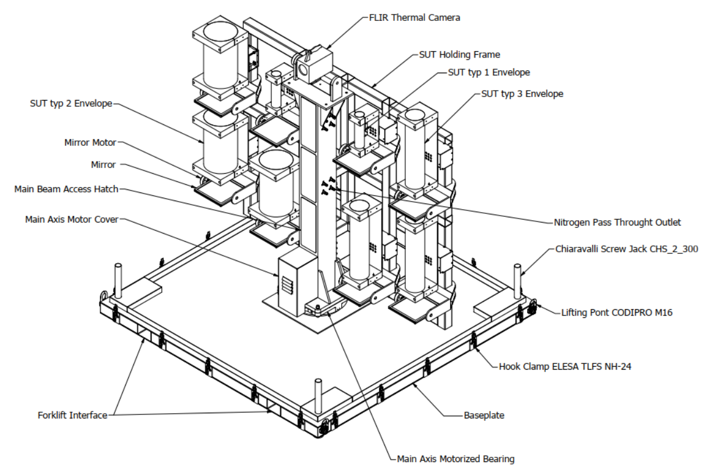
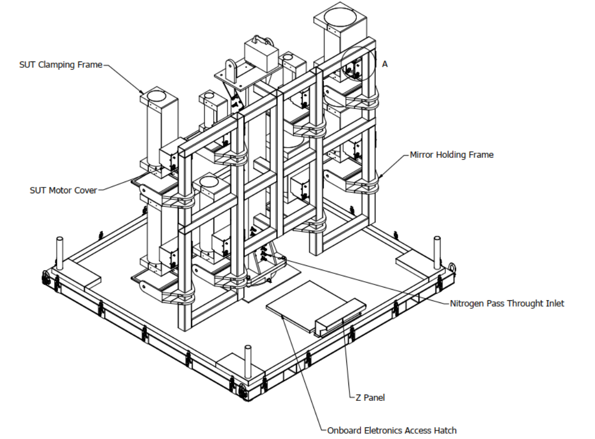
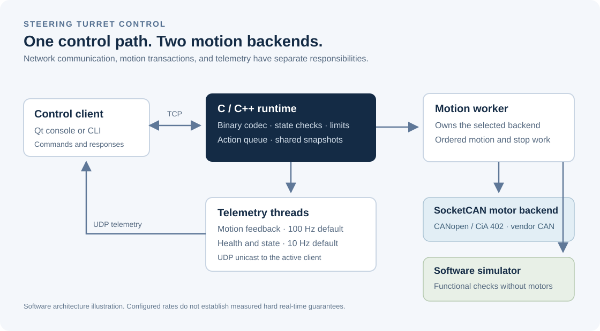
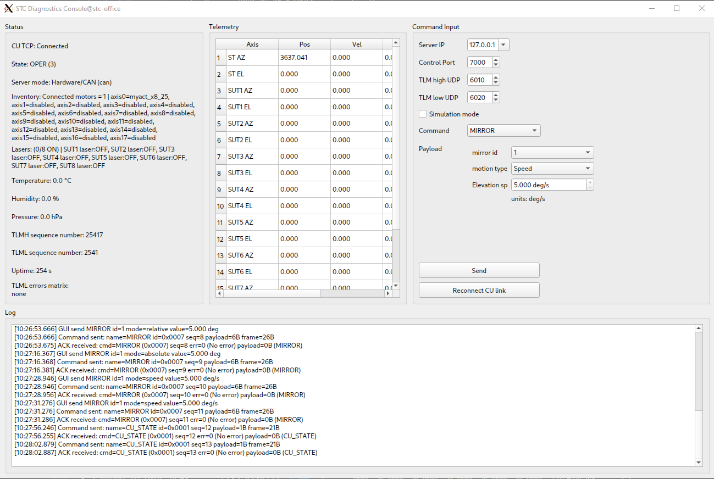
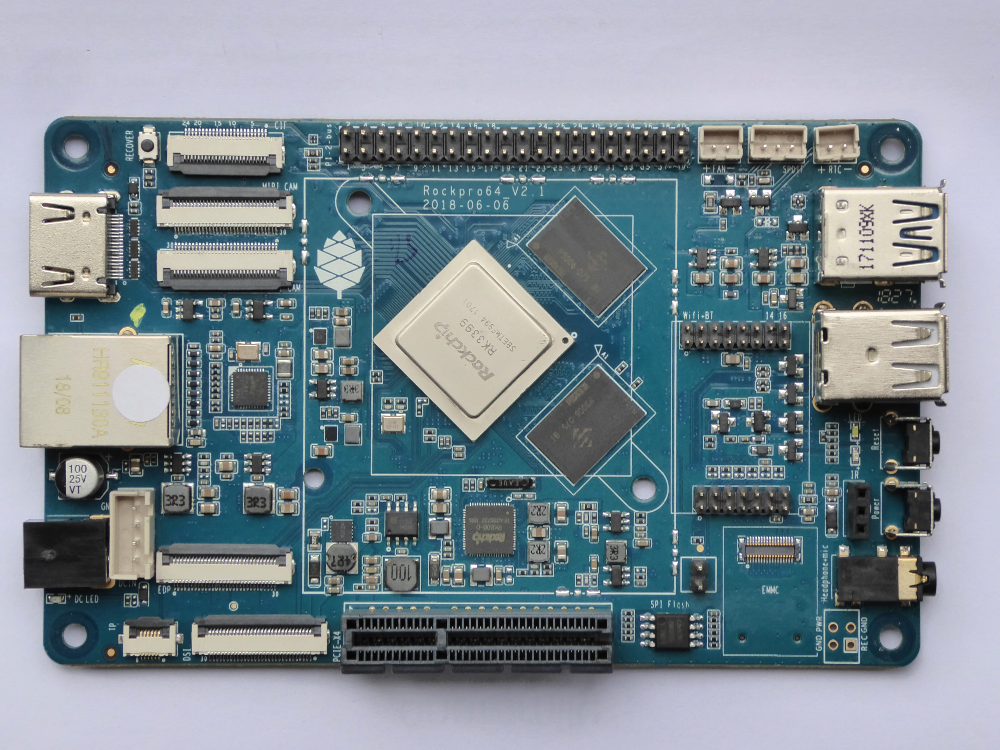

# Steering Turret Control

Low-level embedded Linux control for a military steering turret, with real-time scheduling, CAN motor control, and fault handling for critical defense applications.

<table>
  <tr>
    <th width="50%">Front view</th>
    <th width="50%">Rear view</th>
  </tr>
  <tr>
    <td width="50%" align="center" valign="middle"><a href="docs/images/turret-front.png"></a></td>
    <td width="50%" align="center" valign="middle"><a href="docs/images/turret-back.png"></a></td>
  </tr>
</table>

**C11 / C++17 · Linux / ARM64 · SocketCAN · CANopen / CiA 402 · TCP / UDP · Qt6**

[Engineering report](docs/manuals/steering-turret-report.pdf) · [Build and setup](docs/SETUP.md) · [Software architecture](docs/ARCHITECTURE.md) · [Protocol reference](docs/communication_protocol.md)

## What it does

STC connects a control application to a multi-axis motor system. It receives movement commands, checks whether they are allowed, drives the motors, and sends back position, speed, and health information. A software simulator implements the same motion interface for functional tests.

## Contributions

I was the sole engineer responsible for the control-software stack, from low-level motor integration to diagnostics, hardware testing, and deployment. My work covered:

- **Embedded C/C++ and Linux:** modular control software, POSIX APIs, configuration parsing, and ARM64 deployment on RockPro64.
- **Motor integration:** Nanotec PD4-C CANopen / CiA 402 and MYACTUATOR vendor CAN drivers, including command encoding, feedback, encoder scaling, unit conversion, and real-motor bring-up.
- **Software architecture:** a common motion interface for hardware and simulation, per-axis driver selection, logical axis mapping, and separation of network, control, and telemetry work.
- **Concurrency and timing:** a dedicated motion worker, bounded queues, keep-latest speed updates, mutex-protected shared state, monotonic clocks, and periodic telemetry threads.
- **Fault handling:** state-based motion checks, position and speed limits, stale-feedback detection, speed-stream watchdogs, diagnostic codes, and controlled stop requests after critical faults.
- **Networking and protocols:** a binary TCP command/response codec, explicit little-endian serialization, and UDP telemetry with configurable rates, defaulting to 100 Hz for motion and 10 Hz for health.
- **Diagnostics and verification:** a Qt6 console, command-line clients, actuator bench tools, software simulation, regression and concurrency tests, CAN traffic inspection, and testing with real hardware motors.
- **Build, deployment, and documentation:** CMake, GCC/G++, CTest, systemd services, Linux capabilities, real-time scheduling controls, CPU-affinity configuration, setup guides, and an engineering report.

## System at a glance



The motion worker owns the selected backend. Hardware mode routes each configured axis to the Nanotec or MYACTUATOR library, while simulator mode uses the same motion interface without physical motors. Network and telemetry threads remain separate from motor transactions.

## Technology stack

| Area | Technologies |
|---|---|
| Runtime | C11, C++17, POSIX threads, mutexes, monotonic clocks |
| Platform | Embedded Linux, ARM64, RockPro64 / RK3399 |
| Motor interfaces | Linux SocketCAN, CANopen SDO/PDO, CiA 402, MYACTUATOR CAN |
| Network | TCP commands and responses, UDP unicast telemetry, explicit little-endian encoding |
| Diagnostics | Qt6 Widgets / Network, command-line tools, structured logs |
| Build and verification | CMake, GCC/G++, CTest, protocol and concurrency regression tests |
| Deployment | systemd, Linux capabilities, FIFO/RR scheduling controls, CPU affinity |

## Diagnostics and target hardware



*Qt diagnostic console with live telemetry and motor controls.*



*RockPro64 embedded target.*

## Explore the implementation

| Start here | What it shows |
|---|---|
| [`stc_server.c`](dev/src/stc_server.c) | Runtime threads, command processing, telemetry, and fault coordination |
| [`stc_icd.c`](dev/src/stc_icd.c) | Binary parsing and packing without relying on compiler struct layout |
| [`motion_backend_router.c`](dev/src/motion_backend_router.c) | Shared backend contract for simulation and hardware |
| [`pd4c.c`](dev/src/pd4c.c) / [`x8_25.c`](dev/src/x8_25.c) | Two different low-level motor protocols |
| [`stc_state.c`](dev/src/stc_state.c) / [`stc_limits.c`](dev/src/stc_limits.c) | State transitions and motion checks |
| [`diag_gui_qt.cpp`](dev/tools/diag_gui_qt.cpp) | Operator diagnostics and live hardware inventory |
| [`dev/tests/`](dev/tests/) | Codec, configuration, routing, state, and concurrency tests |

## Build and run software checks

On Linux with CMake and a C/C++ compiler:

```bash
git clone https://github.com/mitsosasim/STC.git
cd STC
cmake -S . -B build -DUSE_SIMULATOR=ON -DBUILD_DIAG_GUI=OFF
cmake --build build -j2
ctest --test-dir build --output-on-failure -LE '^hardware$'
./build/stc_server --backend simulator --rt-enabled 0
```

This no-axis smoke run reports FAIL because the startup motor-inventory check has no configured motors. Status queries remain available. In another terminal:

```bash
./build/icd_tx_tcp 127.0.0.1 7000 req_hw
```

See [Build and setup](docs/SETUP.md) for GUI setup, telemetry, CAN bench work, and service deployment.

## Scope and verification

- Autonomous visual tracking and payload operation are outside the demonstrated control-software scope.
- Laser control is functional in software. A physical laser backend is not integrated.
- Real-time scheduling is configurable. Certified hard real-time deadlines and safety levels are not established here, as they depend on the deployment platform, operating system, workload complexity, and configuration.

**Software engineering: Dimitrios Asimakopoulos**
